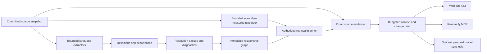

# Making GraphPilot substantially better

Competitive and open-source research · 18 October 2026

**Recommendation:** make GraphPilot exceptionally good at finding evidence and explaining the consequences of a code change. The next investments should be source-content search, explicit analysis coverage, JavaScript/TypeScript support, compact context for agents, and changes compared across snapshots. These strengthen the investigation workflow already described in `PRODUCT.md`.

This is a research report and proposed roadmap. No application features were implemented during this work. The existing application and its uncommitted changes were preserved.

## 1. Executive judgment

GraphPilot already has a useful foundation: source ingestion that does not execute repository code, immutable graph/source snapshots, repository membership checks, durable jobs, source citations, optional personal model credentials, and authenticated read-only MCP. Rebuilding those foundations around a different graph database or a general coding agent would consume time without resolving the largest observed gaps.

The immediate problem is **evidence coverage**. Users can find a Python function by name, but a source literal such as `X-CSRF-Token` is outside the current symbol/metadata search. JavaScript and TypeScript have file references but no semantic symbols. Impact queries have a fixed result cap without an explicit truncation signal. Better prose cannot compensate for missing evidence.

The commercial comparison puts Sourcegraph, Sourcebot, GitHub, and Augment closest to the core search/context problem. CodeScene offers useful lessons in prioritizing work using history. Swimm and DeepWiki show how to turn an unfamiliar repository into guided knowledge. Greptile illustrates change-oriented context and feedback. GitNexus, CodeGraphContext, and codebase-memory-mcp are particularly relevant source-available comparators for graph-based agent tools.

**Proposed positioning to test with users:** “Understand a change, inspect its evidence, and give your agent the right context.” Start with developers maintaining Python backends and TypeScript frontends. This is a product hypothesis based on the current code and market surface; it has not been validated by interviews or conversion data.

The target workflow across sequenced releases should let a developer:

1. Paste an error, header, configuration key, or symbol and reach the exact source.
2. See callers, relevant tests, and missing analysis with clear limits.
3. Compare two indexed snapshots and inspect the changed dependencies.
4. Export a small, cited context bundle to an existing coding agent.

## 2. Method and evidence boundaries

The parent reviewed the current working tree at Git HEAD `765644ced40dbb6ac82943a7a8c4ac78891dad0b`, including preexisting uncommitted changes. The original CLI-focused `docs/COMPETITOR_RESEARCH.md` was read and retained. This report expands into search, code intelligence, change investigation, knowledge capture, and agent context.

The requested **Swe2Max model was used through Devin CLI**, with the exact model selector `swe-2-max`. Exported session metadata identifies `SWE-2 Max`; the installed CLI reports version `3000.11.92`. Two research tracks covered commercial products and open-source implementations, followed by critical review passes. The parent independently checked important claims and reproduced local limitations. Initial drafts contained stale and overbroad claims; this report uses the corrected findings rather than treating model output as evidence by itself.

Evidence is separated into four categories:

| Category | What it establishes | Limits |
|---|---|---|
| Official product documentation | A vendor documents a feature or operating model | Does not establish quality, completeness, speed, or customer outcomes |
| Commit-pinned source inspection | A particular implementation contains the inspected algorithm or contract | Does not prove runtime correctness or production suitability |
| Local probes | The recorded GraphPilot behavior under the specified source/fixture | Small samples; no competitor performance comparison |
| Recommendations | A proposed product or engineering decision | Requires implementation, measurement, and user validation |

The scope is a selected landscape of relevant products and repositories, rather than every product or GitHub project in the category. Paid competitor deployments were not installed or benchmarked. No customer interviews were conducted. Browser inspection could not run because the browser tool repeatedly failed to load its request-header policy; interface recommendations therefore come from current React source and workflow analysis, without visual/a11y scores. No external messages were sent or services published.

Research timing, source inventory, model provenance, and machine-readable observations are included in the companion evidence files. All web sources were accessed on 18 October 2026. Repo claims refer to the pinned commits in [SOURCES.md](SOURCES.md). The final design review's accepted conclusions and parent-verified corrections are in [DESIGN_NOTES.md](DESIGN_NOTES.md); the separate execution plan is [IMPLEMENTATION_HANDOFF.md](IMPLEMENTATION_HANDOFF.md).

## 3. What the current code establishes

### Existing strengths to preserve

| Capability | Current implementation | Product value |
|---|---|---|
| Safe source handling | `api/ingestion/sources.py`; bounded Git/archive inputs, exclusions, no repository imports or hooks | Unknown code can be investigated without running it |
| Conservative Python analysis | `api/ingestion/python.py`; scoped definitions and static relationships; some shadowed/ambiguous bindings withheld, with counterexamples below | A useful abstention baseline to strengthen with precision tests |
| Reproducible investigations | `api/services/revisions.py`, `lifecycle.py`; branch heads, retained snapshots, conversation pins | Earlier evidence can remain tied to its original source generation |
| Durable indexing | `api/services/indexing.py`, `worker.py`; leases, fencing, publication, parse cache | Interrupted jobs need not expose partial graphs |
| Access enforcement | `api/services/permissions.py`, MCP gate, evidence routes | Reads are checked against current GraphPilot membership |
| Provider choice | `api/agent/synthesis.py`, model credentials | Deterministic retrieval works without paid synthesis |
| Agent integration | Five authenticated read-only tools in `api/mcp_server.py` | A useful starting point for an external context service |

These are verified design/implementation properties, not a new security certification. Existing test/deployment reports have their own dated scopes and were not rerun as a release audit here.

### Reproduced observations

The probes use the existing parser and an isolated, disposable FalkorDBLite instance. They do not touch the application's PostgreSQL, graph service, repositories, or accounts. The embedded service was closed and its temporary graphs removed afterward.

| Probe | Observation | Implication |
|---|---|---|
| Exact symbols | `synthesize` and `authenticate_token` each return their definition | Existing identifier lookup is useful |
| Source literals | `X-CSRF-Token`, `Request origin is not allowed`, `python-ast-3`, and `graph_queries` each return zero symbol/metadata hits, despite literal occurrences in the analyzed source | Add source-content retrieval alongside symbol search |
| Query plan | Tested `toLower(n.name) CONTAINS 'token'` uses `Node By Label Scan`; tested exact `id` uses `Node By Index Scan` | Benchmark an indexed lexical path before expanding scale claims |
| Impact limit | 105 synthetic direct callers produce 100 returned callers; response keys are only `results`, `unknown`, and `max_depth` | Explicitly disclose truncation and lower-bound results |
| Impact classification | In two edge-insertion variants, a caller with a direct edge and many two-hop paths is returned at distance 2 | Fix shortest-distance selection before applying caps |
| Citation ranges | A synthetic context-route fixture serves 3,000 characters / 75 lines but reports lines 1–200 and has no `truncated` field | Fix the returned range and truncation metadata, not just context size |
| Parser limits | Direct Python call resolves; local import, typed parameter dispatch, and inherited method probes remain unresolved | Improve resolution in measured stages and retain abstention |
| Binding counterexamples | Rebinding `self`, rebinding a module-level function to a lambda, and an out-of-package relative import can emit misleading `CALLS` targets in synthetic fixtures | Fix false-positive binding cases before expanding heuristic resolution |
| Language coverage | A TypeScript example produces no function/class nodes | Definition-tier JS/TS support is a concrete gap |
| Intent classification | “How is payment failure handled?” becomes `ci_failure` | CI intent should require stronger context than the word “failure” |

The self-analysis covered `api/`, `scripts/`, and `app/src/`: **61 Python files / 12,314 lines and 20 TS/TSX files / 6,276 lines**. The in-memory graph contained 486 nodes and 1,610 relationships. It recorded 954 resolved and 4,488 unresolved call sites. Those unresolved sites include builtins, external libraries, and dynamic behavior: **these counts are not accuracy, precision, or recall measurements**. They support a need for better diagnostics, not a claim that most internal calls are wrong.

The additional binding fixtures expose precision problems as well as missing edges. For example, after `self = Other()`, a subsequent `self.target()` is linked to `Caller.target` in the containing class rather than withheld or resolved using the new binding. A module-level function replaced by a lambda still receives the later call edge. The controls correctly withhold a locally shadowed call and an import from a missing package despite a same-named unrelated definition. These are small, deliberately adversarial cases, not an estimate of real-project error frequency. They also mean the current “verified static” impact label should not be interpreted as an accuracy guarantee. [Adversarial fixture inputs and results](adversarial-probes.json).

The existing retrieval test covers nine synthetic evidence tasks, including a negative query and access-isolation checks. That is valuable regression coverage. It does not yet establish relevance precision, broad natural-language quality, semantic-link accuracy, or human task success. See [graph-probes.json](graph-probes.json), [local-probes.json](local-probes.json), [correctness-probes.json](correctness-probes.json), and [self-analysis.json](self-analysis.json). The citation fixture mocks persistence, retrieval, and synthesis while exercising the actual context route. The impact fixture uses isolated FalkorDBLite; its classification failure was reproduced with the direct edge inserted both first and last.

### Further limits found in source

- Search ranks identifier/path/metadata matches with fixed tiers. It does not index arbitrary source bodies. The overview path samples file categories; it does not produce a complete architecture analysis.
- Context packing selects at most eight evidence excerpts and slices them with character limits. The nominal 24,000 limit uses `len(content)`, not UTF-8 bytes or model tokens. Diagnostics encode bytes separately. More seriously, the context route retains the evidence reader's original `end_line` after this additional slice and drops its `truncated` field. Fix the citation range and flag end to end in the first correctness slice.
- Source-range fidelity needs explicit newline semantics: current `read_text()` normalizes CRLF and `splitlines()` treats U+2028 as a line break. A small text fixture reproduced rewriting and extra lines. The implementation notes also reject the model review's trailing-newline counting formula and relative-import boundary, using independent counterchecks. See [design-edge-checks.json](design-edge-checks.json).
- Citation validation checks whether citation IDs exist. It does not prove that each sentence follows from the cited source. “Evidence-based” should remain inspectable and qualified.
- The graph canvas plots at most 14 nodes on larger viewports and eight on smaller ones, while the loaded node list can be larger. A task-focused path or component view would be more useful than increasing visual density alone.
- History is already used by retrieval for issues, PRs, commits, workflows, and logs. The opportunity is to derive change-oriented investigations from it, rather than merely add another timeline.
- Membership checks and upstream code-host permission synchronization are different capabilities. The GitHub guide explicitly says disconnect removes credentials while indexed snapshots remain. Membership grant/revoke is currently global-admin-only; repository owners have no teammate-management route. Team features therefore need an owner-authorized membership workflow or an explicit single-user scope first. Enterprise access expectations need an explicit policy before adding broader sharing or cross-repository context.
- First-use reliability also needs attention. Deployment docs describe a Codespaces backend with idle shutdown and pending always-awake hosting. A single unauthenticated check during research reached the public landing page (HTTP 200), while `/api/health/ready` returned 404 through the public origin. That observation does not diagnose the cause or establish an uptime rate; it means backend readiness was not established by that probe. A local 8080 readiness probe also returned 404, so no working local app was assumed for a browser review. See [availability-probe.json](availability-probe.json).

## 4. What competitors do better, and what to learn

### Sourcegraph: expressive search and multiple navigation precision levels

Sourcegraph documents content queries with phrase/regex/boolean matching, repository/file/language filters, revision selection, and commit/diff search. Its navigation separates search-based heuristics from precise, uploaded SCIP indexes. This is a useful model for communicating analysis tiers instead of presenting every edge as equally reliable. [Query syntax](https://sourcegraph.com/docs/code-search/queries), [precise navigation](https://sourcegraph.com/docs/code-navigation/precise-code-navigation).

Its Deep Search documentation describes iterative use of search/navigation, with a record of searches and files read. GraphPilot can improve its own retrieval explanations and source selection without first building a general agent. The same page warns that optional shared conversations do not enforce repository permissions for their viewers; GraphPilot should design any sharing around current source access, including derived prose. [Deep Search](https://sourcegraph.com/docs/deep-search).

**Lesson:** build a strong search/navigation substrate, visible scope, and an audit of evidence selection. A citation alone is already common.

### Sourcebot: the closest commercial workflow comparison

Sourcebot documents search and questions across repositories/branches, MCP code search/file reads/definitions/references, and source citations displayed alongside answers. This directly overlaps GraphPilot's intended investigation/context role. [Overview](https://docs.sourcebot.dev/docs/overview), [MCP](https://docs.sourcebot.dev/docs/features/mcp-server), [navigation](https://docs.sourcebot.dev/docs/features/code-navigation).

Its documented paid permission-sync feature applies code-host ACLs to search, navigation, MCP, and Ask; the docs also disclose platform coverage and synchronization delays. GraphPilot has application memberships but not the same documented host-ACL synchronization contract. Its sharing and branch-selection workflows are useful reference points. [Permission syncing](https://docs.sourcebot.dev/docs/features/permission-syncing), [chat sharing](https://docs.sourcebot.dev/docs/features/ask/chat-sharing), [multiple branches](https://docs.sourcebot.dev/docs/features/search/multi-branch-indexing).

**Licensing correction:** the inspected public repository has an MIT license, but its current tree contains deployment/configuration/schema tooling rather than the application runtime source. The runtime image's reuse rights cannot be inferred from that repository license. Its supplied Compose file also includes PostgreSQL and Redis; the initial “single-container open-source application” description was too broad. [Pinned public tree](https://github.com/sourcebot-dev/sourcebot/tree/a5fcd2703e605c08d49ebda9b965997eaf00c21b), [Compose](https://github.com/sourcebot-dev/sourcebot/blob/a5fcd2703e605c08d49ebda9b965997eaf00c21b/docker-compose.yml).

Its v6 guide adds a product-distribution lesson: even the free Basic plan requires activation, limits active users to five, and normally requires license-server connectivity; offline licensing is a separate option. Transparent self-host operation can be a useful GraphPilot positioning hypothesis, but needs clear deployment/support documentation and user validation. It is not evidence that GraphPilot already has stronger enterprise operations. The guide's current Markdown endpoint was independently fetched during this review. [v6 guide](https://docs.sourcebot.dev/docs/upgrade/v5-to-v6-guide.md).

**Lesson:** reduce the friction from question to matching source, offer familiar agent tools, and make access semantics clear. Study the documented workflow; no runtime code was available in the inspected public tree for an implementation comparison.

### GitHub: strong default search/navigation and reusable context collections

GitHub supports regex/boolean/qualified content search and definition search. Its documentation currently limits code search to a repository's default branch and 100 returned results; those restrictions are explicit. Tree-sitter-based navigation extracts definitions/references for supported languages without repository configuration. [Search limits](https://docs.github.com/en/search-github/github-code-search/about-github-code-search), [navigation](https://docs.github.com/en/repositories/working-with-files/using-files/navigating-code-on-github).

Copilot Spaces organizes repositories, code, PRs, issues, notes, and uploads into reusable context. GitHub-based sources update with the project, and viewers can only see sources they can access. [Spaces](https://docs.github.com/en/copilot/concepts/context/spaces).

**Lesson:** code literals, discoverable symbols, saved context, and explicit result limits are baseline expectations. GraphPilot's retained snapshots are a useful foundation for investigations across revisions, without assuming that other products cannot provide reproducibility.

### Augment: context delivery as a product

Augment's current MCP documentation distinguishes a local server indexing the working directory in real time from a remote service indexing selected repositories' default branches and updating on pushes. It documents `codebase-retrieval` and describes semantic/cross-repository awareness and context curation. Those quality descriptions are vendor claims, not independently measured results here. [Context Engine MCP](https://docs.augmentcode.com/context-services/mcp/overview).

**Lesson:** expose high-value task context through a tool a developer already uses. GraphPilot should distinguish a committed source snapshot from any future local working-tree overlay and never silently blend the two.

### Cursor: fast exact discovery and controlled exploration

The canonical English indexing URL now redirects to the Search page. It describes a local Instant Grep index, regex/word-boundary search, and an Explore subagent that returns relevant findings in a separate context. The current page explicitly says it does not store codebase embeddings for search. Older embedding/Merkle-tree descriptions were found, but should not be presented as the current architecture. The speed comparisons on the page are vendor claims. [Current Search documentation](https://cursor.com/docs/agent/tools/search).

**Lesson:** exact search remains central even in an AI-first product. Fast evidence discovery and compact returned context deserve investment independently of an embedding backend.

### CodeScene: prioritize maintenance using behavior over time

CodeScene uses development activity and code-health information to identify hotspots, and describes change coupling between files modified together. Coupling can be appropriate or problematic depending on architecture; it is not proof of a runtime dependency. [Change coupling](https://codescene.io/docs/guides/technical/change-coupling.html), [code health](https://codescene.io/docs/guides/technical/code-health.html).

**Lesson:** GraphPilot can derive transparent churn/co-change signals from sufficiently complete history. Keep counts, time windows, sample size, and exclusions visible. A new proprietary-looking “health score” would be difficult to justify from the current data.

### Swimm: preserve useful knowledge as code moves

Swimm describes detecting documentation/code drift, updating minor snippet/path changes, and asking humans to handle larger changes. This suggests a focused GraphPilot extension: compare saved evidence with a newer snapshot and explain whether the cited source changed. [Auto-sync explanation](https://swimm.io/blog/how-does-swimm-s-auto-sync-feature-work), [CI verification](https://swimm.io/blog/continuous-documentation-through-continuous-integration-with-swimm).

**Lesson:** make past investigations useful again. Preserve the original evidence and show a separately computed drift result; do not silently rewrite old conclusions against new code.

### Greptile: organize context around a change and learn from feedback

Greptile's canonical docs describe graph-based repository context for PR review, custom rules, and learning from team feedback. The documentation's claims of complete understanding and improved outcomes were not independently verified. Older API pages differed from the canonical site's current code-host coverage. [Graph context](https://www.greptile.com/docs/how-greptile-works/graph-based-codebase-context), [memory and learning](https://www.greptile.com/docs/how-greptile-works/memory-and-learning).

**Lesson:** a change is a concrete entry point. GraphPilot can provide a read-only change brief with sources, relevant tests, and unknowns. Feedback should initially improve retrieval evaluation, with suggestions reviewed before becoming team rules.

### SciTools Understand: deterministic analysis can serve agents

Understand documents cross-reference/static-analysis workflows and a local MCP server, `undmcp`, that can use an analysis database through a running GUI or headless mode. Its relevant lesson is the use of existing analysis through agent-facing tools. [Official MCP documentation](https://docs.scitools.com/help/ai/connect-via-mcp.html).

**Lesson:** developers should be able to query the analysis they already indexed. MCP needs useful contracts and precise locations, rather than a large tool count.

### DeepWiki: a structured first encounter with a repository

Devin documents generated repository wikis with architecture diagrams and source links, with configurable page structure and priorities. This addresses the blank-page problem for an unfamiliar codebase. It does not establish that generated explanations are complete or correct. [DeepWiki](https://docs.devin.ai/work-with-devin/deepwiki).

**Lesson:** provide a guided repository overview and reusable tours. Start with deterministic entry points, modules, definitions, and dependencies; optional prose can sit on those verified references.

## 5. Open-source implementation lessons

Upstream issue history reinforces two requirements without proving a current defect rate. GitNexus issue #1858, now closed, describes the risk of presenting unresolved indirection as zero impact; its inspected source already contains explicit resolution outcomes. In codebase-memory-mcp #1084, a maintainer identified a broad-directory auto-index guard gap, alongside version-specific resource reports. These are lessons for visible unknowns, explicit roots and measured resource budgets, not evidence that current releases universally fail. [GitNexus discussion](https://github.com/abhigyanpatwari/GitNexus/issues/1858), [resource-usage discussion](https://github.com/DeusData/codebase-memory-mcp/issues/1084).

The companion [SOURCES.md](SOURCES.md) records commits, licenses, source paths, and inspection depth. “Better” below means stronger in a specified implementation dimension; it does not mean the complete project is a better replacement for GraphPilot.

| Project | Stronger implementation pattern | Useful GraphPilot application | Important boundary |
|---|---|---|---|
| Aider | Definition/reference tags, personalized graph ranking, fitting a repository map to a token budget | A query-focused map and compact signatures before full excerpts | Name co-occurrence is a ranking signal, not a verified call edge |
| Continue | Separate incremental indexing artifacts; content retrieval alongside symbol/snippet indexes | A lexical + identifier + graph retrieval portfolio | Preserve snapshot/ACL boundaries; its editor recency signal differs from server snapshots |
| Zoekt | Dedicated trigram content search and structured match scoring | Reference design for a later large-corpus search backend | A new service introduces deployment, ACL, and snapshot mapping work |
| SCIP | Symbol identities, source occurrences, roles, and relationships | An occurrence contract and optional imported precise indexes | The format alone guarantees neither precision nor a call graph |
| scip-typescript / scip-python | Type-aware symbol occurrence generation | Externally generated, commit-bound index import as a later precision tier | Do not install a repository's dependencies inside the ordinary ingestion path |
| Repomix | Context packaging, token accounting, compact source representation | Cited Markdown/JSON context export with explicit omissions | Compression can remove relevant behavior; secret detection is best effort |
| ast-grep | Syntax-aware patterns and metavariables | Optional structural searches or a small catalog of investigation patterns | Syntax matches are not resolved references |
| dependency-cruiser | Declared dependency rules with named violations | Architecture boundaries with an explainable violating edge/path | A syntactic import may not be a runtime dependency |
| FalkorDB/code-graph | Static resolver option, richer structural tools, cached lexical/graph ranking | Reassess selected resolver/search designs without adopting the runtime wholesale | Default environment/LSP paths and global name fallbacks need separate scrutiny |
| GitNexus | Resolution passes, explicit suppressed/guessed outcomes, change/context tools | Record why a link is missing; separate hypotheses from verified relationships | Inspected license is PolyForm Noncommercial; do not assume commercial reuse rights |
| CodeGraphContext | Multi-language pipeline, per-call diagnostics, watcher and SCIP paths | Extractor contracts, failure accounting, bounded background refresh design | Its heuristic tiers should not become GraphPilot “verified” facts |
| codebase-memory-mcp | Local graph tools, typed extraction passes, staged publication and resource-limit errors | Specific coverage states, committed-change workflows, operational diagnostics | Its performance/token claims were not reproduced here |
| Serena | Symbol-addressed reference/navigation tools | Human-readable symbol addressing and focused MCP operations | Live language-server environments differ from archived snapshot ingestion; component licenses differ |
| LightRAG | Separate entity/relationship retrieval paths and context merging | Experiment with retrieval diversification | Mandatory model-generated graph facts would conflict with GraphPilot's deterministic core |
| deepwiki-open | Structured wiki pages, generation progress, source-link presentation | Guided overviews and evidence-linked tours | The inspected wiki task registry is in memory; retain GraphPilot's durable job system |

The most actionable source patterns are **token-budgeted context**, **separate source search**, **occurrence-level provenance**, **resolution failure accounting**, and **change-oriented tools**. They fit the existing architecture more naturally than a full-stack replacement.

## 6. Prioritized roadmap

Priorities below are judgments based on observed gaps, architectural fit, and likely user value. They are not measured demand. Effort is a rough engineering hypothesis for someone familiar with this codebase: **S = 1–3 working days, M = 4–10 days, L = 2–4 weeks, XL = more than four weeks**. Work packages overlap; adding the estimates does not produce a reliable delivery date. Research, review, deployment constraints, and parser edge cases can extend them.

| Rank | Work package | Priority / effort | Confidence in value | Reason |
|---|---|---|---|---|
| 1 | Binding/citation correctness, coverage and truncation | P0 / S–M | High | False targets, misleading citation ranges, silently capped impact |
| 2 | Snapshot-scoped source-content search | P0 / S–M bounded scan; M–L durable index | High | Reproduced misses for ordinary source literals |
| 3 | Retrieval and semantic-link evaluation | P0 / M initially, ongoing | High | Needed to distinguish improvement from plausible output |
| 4 | JS/TS/TSX definition indexing | P0 / L | High | Own frontend lacks semantic symbols |
| 5 | Task-aware question interpretation | P1 / S–M | High | Reproduced CI misclassification and weak generic prompts |
| 6 | Token-budgeted context and repository map | P1 / M–L | High | Strong fit for existing graph, artifacts, and MCP |
| 7 | Occurrence model and resolver diagnostics | P1 / L | High | Makes precision levels inspectable and extensible |
| 8 | Compare snapshots and produce a change brief | P1 / L | Medium–high | Combines existing snapshots, history, source, and impact |
| 9 | More useful MCP read operations | P0 thin search/read surface; P1 bundles | High | Expose the first slice immediately through existing agents |
| 10 | Evidence-focused UX and reliable first investigation | P1 / M, hosting separate | Medium–high | Helps users reach and finish a useful task |
| 11 | Membership workflow, then saved investigations | P2 / M–L each | Medium | Owner-authorized grants are a prerequisite for ordinary team use |
| 12 | Evidence drift comparison | P2 / M–L after snapshot diff | Medium–high | Extends the useful life of past findings |
| 13 | Background freshness and host-access policy | P2 / M–L polling; L–XL push + policy | Medium–high for team use | No current webhook ingress or host-identity mapping |
| 14 | Explainable churn/co-change views | P2 / M–L | Medium | Uses history to direct maintenance attention |
| 15 | Architecture boundaries and dependency rules | P2 / L | Medium | Converts exploration into repeatable checks |
| 16 | Optional imported SCIP precision tier | P2 / L–XL | Medium | Improves references without installing project dependencies server-side |
| 17 | Cross-repository investigations | P3 / XL | Medium; depends on target teams | Valuable for services, but increases scope/ACL/version complexity |
| 18 | Optional local semantic retrieval | P3 / L plus evaluation | Unproven locally | Could improve concept queries; measure against lexical/graph baseline |
| 19 | Component grouping and guided tours | P3 / M–L | Medium | Helps unfamiliar codebases after basic evidence coverage improves |
| 20 | Broader language and infrastructure relations | P3 / XL across languages | Varies | Expand from demonstrated user demand and evaluated adapters |

### 6.1 Coverage should be a first-class result

Return limits and uncertainty as structured fields across search, neighbors, paths, impact, and context. A generic dynamic-dispatch warning does not disclose a server-side cap.

**Proposed contract:** `returned`, `limit`, `truncated`, `completion_reason`, `max_depth`, `source_snapshot`, `analysis_tier`, and `unresolved_internal_sites`. If obtaining an exact total is expensive, report that it is unknown. Querying one extra row can detect a simple cap; path deduplication requires care because a path cap and a unique-caller cap differ. Today `impact()` limits paths before deduplication and shortest-distance selection. Do not assume the selected paths contain every origin's shortest path: aggregate minimum distance before limiting origins, or use another bounded algorithm with an explicit contract. Preserve edge direction in task-specific caller/callee operations; an undirected discovery path is not a directed call chain.

**Acceptance:** the 105-caller fixture clearly indicates that the returned set is incomplete. Capping path enumeration must not downgrade a known direct caller to indirect. A zero-result query says “no recorded callers in the analyzed scope,” with unsupported languages and unresolved internal sites visible. A user can distinguish capacity limits, missing semantics, expired artifacts, and a genuine empty result. A citation shortened by the context packer has a correct returned line range, explicit truncation, and a way to open the full source; this metadata survives API, saved conversation, TypeScript types, and rendering.

Include a small binding-correctness patch in this first slice: withhold unsupported rebound-receiver/module-binding cases, reject invalid relative-import resolution beyond the package root, and add the adversarial fixtures before attempting broader resolution. The first goal is fewer false recorded targets, even if a few more calls become explicitly unresolved.

**Seams:** `api/graph/store.py`, repository/MCP response types, `app/src/lib/api.ts`, impact and diagnostics views. Preserve bounded queries rather than removing caps.

One candidate design is incoming, layer-by-layer traversal that stops when an earlier layer is incomplete, rather than continuing and calling a later discovered path globally shortest. An abstract research model matched independent Floyd–Warshall distances on all 4,096 simple four-node directed graphs without self-loops, across three caps (12,288 cases). This is evidence about that small model's cap semantics, **not GraphPilot implementation or database/resource validation**. Real queries still need row/work limits, timeouts, duplicate-edge handling and integration tests. Do not assume a built-in BFS procedure supplies incoming multi-type traversal or that a result `LIMIT` bounds its internal work. [Model check](traversal-contract-check.json), [FalkorDB BFS interface](https://docs.falkordb.com/algorithms/bfs).

### 6.2 Add source search as a separate retrieval capability

Support literal content and identifier/path search with a clear mode. Start with a small set of filters—path, language, symbol kind, and snapshot—using typed parameters. A full query language can follow after those operations work well. Each hit must include the actual matching span and a route to the exact immutable source.

An isolated SQLite FTS5 trigram spike returned all known literal-containing files for the four missed queries. A two-character `xy` query returned none despite four literal-containing files. This demonstrates both the value of content retrieval and a short-query edge case. It is **not a decision to add SQLite to production**. [Recorded spike](search-index-probe.json).

**Start with a bounded literal scan of the already-protected snapshot tree.** Apply repository membership and the same storage read lock as evidence reads; enumerate only the ingestion-approved source manifest. Bound files, bytes, elapsed work and matches, and return what was scanned, why scanning stopped, and whether more may exist. A path filter makes this useful even before a durable index. Verify retained-snapshot reads and deletion races. This is the lowest-cost way to repair the reproduced literal misses and establish a baseline; it is not a large-corpus latency solution.

When corpus and latency measurements justify an index, compare:

- Use existing PostgreSQL for a protected, snapshot/file-hash-keyed lexical index. Evaluate `pg_trgm` for literal candidates and appropriate text search for prose; preserve punctuation and verify exact literals against source. This would put source bytes in PostgreSQL for the first time and changes backup/retention costs; deduplicate content by hash without losing snapshot membership.
- Use FalkorDB full-text indexes for normalized symbol/path/doc metadata while keeping source-content retrieval separate from graph properties. An isolated readiness-checked probe confirmed full-text queries work, but adding an index to metadata does not make source bodies searchable. The probe's snake/camel partial matches depended on an explicit normalized `terms` property, not raw-name tokenization. Index readiness, retained-graph memory, and copied-index cost still need measurement.

PostgreSQL documents trigram indexes for similarity, `LIKE`/`ILIKE`, and regex candidates; non-word characters and short patterns need explicit tests. Patterns without extractable trigrams can degrade to a full-index scan rather than losing correct results; that differs from the SQLite spike's short-query miss. FalkorDB documents full-text tokenization, stemming, and scoring. Neither is a semantic drop-in replacement for the current search contract. [PostgreSQL `pg_trgm`](https://www.postgresql.org/docs/current/pgtrgm.html), [FalkorDB full-text](https://docs.falkordb.com/cypher/indexing/fulltext-index).

**Acceptance:** all four reproduced literals return matching lines; exact symbol lookup remains strong; snake_case/camelCase, quotes, punctuation, Unicode, short queries, and zero matches have defined behavior. No result crosses a repository/snapshot boundary. A missing/out-of-date text index is disclosed and does not silently publish partial coverage.

**Seams:** source publication in `services/indexing.py`, protected index-artifact metadata, `search/retrieval.py`, a bounded content-search route/tool, lifecycle cleanup. Consider an exact-name fast path before broader matching. Defer a Zoekt sidecar until corpus/latency measurements justify the operational cost.

### 6.3 Ship JavaScript/TypeScript in precision stages

Begin with definitions, signatures, exports/import syntax, and exact source ranges for `.js`, `.jsx`, `.ts`, and `.tsx`. Test modern TypeScript declarations and React components. A parser adapter should emit a common intermediate representation rather than directly writing arbitrary graph edges. Interfaces and type aliases need an honest symbol kind, either through a generic `Symbol` with `symbol_kind` or new whitelisted kinds; they must not be mislabeled as functions/classes. A first release can advertise a narrower supported declaration set.

Then add scoped import/re-export resolution and selected unambiguous references. Keep call resolution separately labeled. Parsing a call expression establishes that the expression exists; it does not establish its target or runtime execution.

**Acceptance:** the GraphPilot frontend has searchable supported component/function/type definitions; evidence spans are correct for multiline signatures, decorators/annotations, generics, nested definitions, Unicode, and partial syntax. Unsupported declarations are disclosed. A definition-only symbol does not display a misleading “no impact” result. Use pinned packaged grammars and bounded analysis workers; repository-provided parser plugins do not enter the ingestion path. Parser upgrades invalidate the correct cache artifacts without rewriting retained snapshots.

**Seams:** a new extractor registry beside `ingestion/python.py`, versioned parsed artifacts, node/edge allowlists, coverage metadata and UI labels. The current `SourceFile` row is a mutable `(repository, branch, path)` head cache, not retained-snapshot truth. New occurrences/index artifacts must be keyed by immutable snapshot/tree, path and content hash; reuse the cache without deriving historical facts from its current values. A generic `Symbol` carrying `symbol_kind` is the recommended initial schema choice, with matching updates to filters, statistics and canvas labels. Add Go, Java, or another language only after real target repositories and accuracy fixtures identify the next priority.

### 6.4 Improve question interpretation and task guidance

Make “find this literal,” “find callers,” “inspect changed files,” “explain this path,” and “investigate this workflow” explicit tasks. A general word such as “failure” should not automatically select CI. Preserve exact strings and user-provided locations before deriving broad keywords.

Suggested questions should reflect indexed evidence. A definition-only repository can offer file/symbol lookup; a synced failing workflow can offer a CI investigation. Broad feature-improvement prompts currently exceed what a small source sample can establish.

**Acceptance:** the payment-failure example stays in code lookup unless CI/workflow context is present. Follow-ups retain explicit entity/snapshot selections. The UI explains the deterministic task result clearly when no model is configured, and offers a next action backed by available evidence.

**Seams:** `interpret()` and follow-up handling in `search/retrieval.py`, Ask page starters, scoped entity selection. A small deterministic planner is a practical first step. Any later model planner must call bounded read operations with the same permissions.

### 6.5 Pack context around a task and a real budget

Create three context levels: repository/module map, compact symbol signatures, and selected source excerpts. Deduplicate overlapping ranges, preserve exact matching locations, and reserve budget for the question, relationships, provenance, unknowns, and output. Fit content by an explicit tokenizer where supported; label fallback estimates as estimates.

Aider's graph-ranked map and Repomix's packaging are useful patterns. Use GraphPilot's recorded relationships as a ranking signal; avoid importing their heuristic name links as verified graph facts. Compare simple lexical/graph ranking with personalized centrality before adding complexity.

**Proposed output:** `context_bundle` containing repository/snapshot IDs, task, entities, source spans, relationships, selection reasons, tokenizer/estimate, token count, omitted items, and coverage. Offer Markdown for humans and JSON for tools. Build from the same evidence service used by the browser.

**Acceptance:** a requested context budget is respected; repeated source ranges appear once; every excerpt resolves to exact source; omitted evidence is counted/disclosed. The default bundle works without a provider and can be regenerated from a retained snapshot. Export checks current access and preserves existing secret-handling boundaries.

**Seams:** `routes/context.py`, a provider-independent context-packing module, evidence readers, CLI/MCP. Caching must include snapshot, extractor/ranking version, task inputs, and authorization scope.

### 6.6 Record occurrences and explain missing relationships

Preserve source occurrences with roles such as definition, reference, import, read, write, and call-expression. Record resolution outcomes separately: resolved by scope/import/type evidence, ambiguous, unsupported, external, or unresolved internal. Counts alone cannot tell whether a missing edge is an analysis defect or a call to code outside the repository.

GitNexus's explicit resolution/suppression outcomes and CodeGraphContext's per-call diagnostics are useful references. Their numeric confidence weights are implementation heuristics, not calibrated probabilities. GraphPilot should expose reasons and provenance before considering numerical confidence.

**Acceptance:** local-import and inheritance fixtures either resolve through a documented rule or return an inspectable unresolved reason. Rebound receivers and module-level rebinding do not keep an obsolete target. Unique bare-name matches remain hypotheses or are withheld. Missing dependencies cannot turn an unrelated same-named function into a verified target. References and call expressions remain distinct.

**Seams:** parsed-file representation, `build_graph()` resolution passes, artifact/version schema, diagnostics and source navigation. Keep conservative Python behavior as a baseline during migration.

### 6.7 Turn snapshots into a change investigation

Compare a base and head snapshot: changed files/definitions, added/removed recorded relationships, affected callers, tests reached by explicit static call paths, and relevant PR/CI evidence. Present a read-only brief with source links and visible gaps. Start with two snapshots on the same branch: current stable IDs include the branch but not commit, so unchanged qualified identities can be compared by ID plus source fingerprints. Cross-branch matching and rename inference are a later, larger slice. GitHub file metadata alone does not establish which symbols changed; both source snapshots and actual ranges are needed.

**Acceptance:** a known same-branch function change identifies the changed definition, direct recorded dependents, and relevant test-call paths. The report names both commits and coverage windows. The later cross-branch/rename tier must not compare branch-scoped hashed IDs directly: match qualified identities and source fingerprints with explicit uncertainty, and do not label an ambiguous rename as a certain deletion. Current GitHub synchronization does not retain `previous_filename`, and history rows can survive upstream fetch failures/404s; treat those records as dated context, not authoritative diff truth.

**Seams:** revisions, source manifests, history metadata, impact queries, a bounded diff job, Activity/Code presentation. Keep the current three main repository tabs; a “Compare changes” workflow can live within them.

### 6.8 Extend MCP around useful read tasks

Expose bounded content search and exact source-range reads with the first search slice. Then add `find_references`, `get_context_bundle`, `explain_path`, `compare_snapshots`, and `get_history_evidence` as their underlying capabilities become available. Add tools because they save a concrete sequence of reads, with narrow schemas and small outputs; raw tool count is not a quality metric. Reuse HTTP/evidence implementations to avoid two sets of access or source-selection rules.

Make discovery usable beyond the current first 50 repositories: add authorized pagination or filtering. Return immutable snapshot handles consistently, including repository discovery, and let clients thread that handle through search, evidence, impact and export. Current optional revision selection provides a base, but default-head calls can observe different generations if indexing finishes between reads.

**Acceptance:** an external client can complete literal lookup → evidence → callers → context export, with commit/snapshot provenance and bounded payloads. A revoked token or membership blocks all relevant operations, including cached responses. Unsupported analysis and truncation are structured results. A tool that would call a paid provider is separately named/scoped and never hidden inside an otherwise deterministic read.

### 6.9 Make investigations easier to finish

Place the selected source, matching lines, callers/callees, and relevant tests together. Use the graph to show the selected path or component. A large radial display should not be required to understand a result. Keep keyboard-accessible lists, history, and exact branch/snapshot context visible.

Good initial task panels are: “Where is this implemented?”, “Who depends on this?”, “What changed?”, and “Why is this workflow failing?” Each should return evidence and a small set of actions. Surface coverage near the result instead of burying it in diagnostics.

Measure the full first-use sequence as well: reachable backend, account/access, repository connection, live worker, successful index, first useful result. The public landing page alone is insufficient. Expose an actionable sleeping/unavailable-backend state and distinguish API readiness from worker liveness. Improve install/preflight guidance around the existing Compose/CLI tooling before building another environment-control surface. Any hosted reliability change depends on the user's hosting/cost decisions; the report does not assume a paid deployment or change the current setup.

**Acceptance:** a developer can reach matching source from a literal without knowing a symbol name; complete caller navigation with a keyboard; reopen the investigation at its original snapshot; and understand an empty/partial result. Validate those outcomes in a browser and with representative users before attaching UX improvement claims.

### 6.10 Reuse investigations without weakening access

First decide the membership workflow. Today only a global admin can grant/revoke repository membership. Add owner-authorized teammate management with audited grants, an explicit role ceiling and no owner/admin escalation, or keep the near-term release explicitly single-user. Do not promise ordinary self-service team sharing while this prerequisite is absent.

Then add a saved investigation consisting of selected evidence, task parameters, findings, and source snapshots. A link should check current access to all source scopes supporting its prose, not merely hide unauthorized citations. Scope sharing to existing members initially. Define ownership/retention when a user is deleted before making personal conversations shared artifacts.

For drift, preserve the original and compare against a new snapshot. Suggested states are unchanged, moved candidate, changed, removed candidate, and unknown. A matching content fingerprint can establish identical bytes; it does not prove unchanged runtime behavior.

**Acceptance:** removing a viewer's membership prevents new reads of the saved finding, its derived prose, excerpts, and exports. A retained historical finding still opens its old evidence. Drift does not rewrite old citations; ambiguous renames remain ambiguous. Retention/pinning and repository deletion include the new artifacts.

### 6.11 Derive history signals transparently

Compute churn in a stated window, co-change support counts, and relevant failure metadata. Exclude or separately label large formatting/vendor/bot commits, and expose incomplete history. File pairs changing together are correlations, not verified dependencies.

A useful maintenance view could combine frequent changes with many recorded dependents and nearby failed-test evidence. Show the components and source links so users can judge them. Avoid employee productivity or competence scores from commit activity.

**Acceptance:** a synthetic history with known co-change pairs yields the expected counts; shallow/incomplete history produces a warning; filters and time windows are repeatable. “Related test” labels distinguish explicit static call paths from imported runtime coverage. Current `TESTS` edges mean resolved direct calls from `test_`-prefixed functions, not test execution, transitive coverage or every affected behavior. Commit rows currently omit author/committer metadata, so ownership or bus-factor analysis is not available from the data already held.

### 6.12 Treat advanced capabilities as separate decisions

- **Imported SCIP:** accept a bounded index only after importer-side repository, exact source commit, file path/hash and range validation. Tool metadata is self-declared: record it as uploader-asserted rather than authenticated tool identity. Support the pinned protocol's range variants and position encoding; the inspected current proto deprecates packed `range` in favor of `typed_range`, whose single/multiline fields take precedence. Matching source hashes establishes alignment, not the correctness of uploaded relationships. An untrusted upload remains producer-asserted until a defined verification/trust policy is satisfied. Run no project indexer during ordinary server ingestion. References do not automatically become `CALLS`.
- **Architecture rules:** support named path/module boundaries and explain violations with exact edges and scope. Reuse a deterministic rule catalog; do not accept arbitrary executable repository configuration.
- **Freshness:** begin with bounded scheduled checks, coalesce duplicate heads, and publish complete generations using existing fencing. Push needs a new authenticated webhook ingress, signature/replay handling and job coalescing, so estimate it separately. A local uncommitted overlay requires a separate identity and label.
- **Host permissions:** choose whether GraphPilot membership remains authoritative or host revocation is periodically enforced. The present connecting-user host check runs at indexing/sync; it does not revoke retained-snapshot reads, and there is no member-to-host identity mapping. Define sync intervals, failure policy and revocation semantics before promising inherited host permissions or broad cross-repo search.
- **Cross-repo context:** use an explicit vector of authorized repository snapshots. Verify every participating scope before retrieval, ranking, counts, cached results, or synthesis. A logical API link across services needs evidence beyond a matching string.
- **Semantic retrieval:** test optional local embeddings against the same lexical/graph corpus, including costs, resource use, freshness and failure behavior. Keep model-derived similarity separate from recorded facts.
- **Component grouping:** compare folder/module grouping with graph-only clustering. A clustering algorithm need not use an LLM; generated community summaries do. Adopt either only if users finish relevant navigation tasks more effectively.

## 7. Architecture that supports these improvements

The graph should remain the relationship store; protected source artifacts remain the source of truth for code. Add a versioned search/context artifact alongside them. Publish a snapshot only when the required artifacts for its advertised coverage are ready, or explicitly label a partially available optional capability.



Proposed records, rather than a committed schema design:

```text
IndexArtifact
  repository_id, snapshot_id, artifact_kind, source_tree_hash,
  extractor_version, ranking_version, state, coverage, storage_ref

SourceOccurrence
  snapshot_id, file_hash, path, language, symbol_identity,
  start_line, start_column, end_line, end_column, range_encoding,
  role, extractor, extractor_version

ResolutionOutcome
  occurrence_id, status, rule, target_identity?, candidate_identities[],
  external_or_internal, evidence_refs[]

ContextBundle
  task, repository_snapshots[], source_spans[], relationships[],
  selection_reasons[], coverage, tokenizer, token_count_or_estimate,
  omitted_items, generated_at
```

Important design details:

1. **Ranking and certainty are independent.** An exact text hit can be highly relevant without proving a dependency. A compiler-backed reference can be accurately resolved and irrelevant to this question. Use separate fields.
2. **Snapshot identity is authoritative.** A branch name changes over time. Every artifact, source span, cached context, diff, and imported index needs an immutable generation identity.
3. **Analysis failures remain visible.** Store unresolved/unsupported outcomes and parser failures. Keep successful prior generations available if a new build fails.
4. **Authorization covers derived content.** Search indexes, summaries, result counts, exports, and caches can reveal code even when the raw source route is protected.
5. **New artifacts need lifecycle management.** Publication fencing, rollback, retention, deletion, backup, and restore must include text indexes and saved context. Existing graph/source protections should not be bypassed by a side index.
6. **Source-range fidelity is part of correctness.** UTF-8 byte offsets, UTF-16 columns, tabs, CRLF, and multiline signatures need explicit conversion and tests. Line numbers attached to a truncated excerpt should describe the returned text precisely.

## 8. Evaluation and release gates

The following are **proposed checks and targets to establish**, not results already achieved.

### Corpus and ground truth

Use three complementary sets:

| Set | Purpose | Examples |
|---|---|---|
| Adversarial fixtures | Know exact expected edges and omissions | Shadowed/rebound names and receivers, local/out-of-package imports, inheritance, re-exports, missing dependencies, duplicate names, Unicode ranges, cycles, deleted/renamed files |
| Pinned public repositories | Test realistic shapes and size | Python service/library; TS/React application; mixed-language monorepo; a larger repository within published capacity |
| GraphPilot dogfood tasks | Verify usefulness on this application | Locate `X-CSRF-Token`; explain source authorization; trace indexing publication; identify frontend users of an API; compare a changed retrieval function |

Annotate source spans, relevant entities, valid relationships, expected unknowns, and current access. Split tasks into development and held-out sets. Avoid tuning and reporting on the same tiny fixture set. Keep corpus SHAs, query definitions, expected answers, and evaluation configuration under version control.

### Measure the layers separately

- **Search:** exact/literal hit rate, Recall@k, Precision@k, MRR or nDCG for ranked tasks, zero-result quality, duplicate excerpts, and short/punctuation query behavior.
- **Analysis:** definition extraction precision/recall, reference-target precision/recall, unsupported versus external sites, call-expression attribution, and false verified edges. A higher resolution count alone is not an improvement.
- **Impact:** direct/indirect edge/path correctness, returned-set completeness within limits, cycle handling, cap disclosure, and missing-language notices. A broad blast-radius list is not automatically a better one.
- **Context:** citation source/range/hash validity, task-relevant evidence coverage, token-budget compliance, duplicated spans, omitted-evidence disclosure, and answer-claim support where synthesis is enabled.
- **Operations:** full/incremental/no-change indexing, cancellation and failure publication, text-index consistency, retained-snapshot reads, cleanup, and restore. Measure cold/warm p50/p95 by repository size, hardware, and concurrency.
- **Access:** cross-repository isolation, revoked users/tokens/memberships, authorization-aware caches, sharing-derived text, permission-sync failure policy, and absence of source leakage through counts or errors.
- **Product:** time to reach the correct source, successful change investigation, confidence calibrated to missing evidence, and reuse of a saved context bundle. Measure before/after with representative users.

### Minimum gates for the first improvement release

All reproduced content queries should return exact source locations, including a held-out match beyond the initial 200-line File excerpt. Existing exact-symbol tasks must remain correct. The 105-caller fixture must explicitly disclose incompleteness; the cap-induced direct-to-indirect misclassification must disappear. The reproduced binding counterexamples must no longer emit their obsolete/invalid targets. Context citations must report the served range and preserve truncation. Every emitted verified relationship in the golden fixtures must have its expected target and provenance; guessed matches cannot be silently promoted. Evidence must resolve to the pinned source generation and permitted scope. Budget limits must be enforced even with Unicode or long identifiers. Optional index/model failure must produce a clear fallback rather than a false complete answer.

Set latency and relevance thresholds after recording a reproducible baseline on agreed hardware and corpora. Do not convert the small local timings below into an SLA or an advertised speedup.

### Additional local search observations

An isolated synthetic lookup compared a full-name substring query with an exact indexed-name query that returned the same single result. Twenty measured repetitions followed two warmups at each size:

| Synthetic entities | Substring median / p95 ms | Exact-name median / p95 ms |
|---:|---:|---:|
| 1,000 | 0.843 / 1.161 | 0.128 / 0.316 |
| 10,000 | 4.739 / 5.744 | 0.125 / 0.162 |
| 50,000 | 23.019 / 24.507 | 0.129 / 0.220 |

This only supports investigating an exact lookup path and indexed lexical candidates. It measures a small local synthetic graph, not the complete API, authentication, ranking, source loading, concurrent users, or a competitor. Exact equality and substring search have different general semantics. The first full-text subtest failed to check asynchronous index readiness and is marked inconclusive; a separate check recorded an `OPERATIONAL` index and successful queries. [Spike data](search-index-probe.json), [readiness-checked full-text probe](fulltext-check.json).

## 9. Suggested sequencing and product validation

**First vertical slice:** conservative binding fixes, citation range/truncation fixes, impact correctness/completeness, bounded literal search with exact source spans, stronger question routing, and regression fixtures. Demonstrate the same investigation through the web and MCP. This establishes a credible improvement users can immediately inspect. The separate implementation chat should begin with this slice and verify it before moving through the next dependencies; the full roadmap is not a promise of completion in a few hours.

**Next slice:** JS/TS definitions and source navigation, compact repository maps/context bundles, then a base/head change brief. Start reference resolution with small evaluated rules rather than promising broad semantic parity.

**Team slice:** owner-authorized membership workflow first, then saved investigations, evidence drift, freshness, host-access policy, and explainable history signals. Add architecture rules or imported SCIP when actual users need their precision/workflows.

**Scale slice:** cross-repository context and a dedicated search service only after target repositories and measurements establish that the existing stack is insufficient. Optional semantic retrieval should earn its place on held-out tasks.

A 30/60/90-day plan is best used as a review cadence, not a promise that all these packages fit:

| Review point | Evidence to seek | Decision |
|---|---|---|
| Around 30 days | Reliable literal/source search, explicit coverage, JS/TS definition progress, baseline relevance data | Is the core investigation materially easier? |
| Around 60 days | Context bundles and change briefs evaluated on real tasks; resolver diagnostics visible | Which precision and workflow gaps matter most? |
| Around 90 days | Reused investigations, freshness/access behavior, pilot feedback and operating measurements | Expand teams/repositories/languages or deepen the current use case? |

Before committing to a large expansion, run a small pilot with developers unfamiliar with selected code. Have them locate a source literal, identify dependents, explain a known change, investigate a CI failure, and hand context to their normal agent. Observe errors and missing evidence. Interview them about frequency and whether the result replaced a real sequence of manual steps. Those findings should change the ranking if cross-repo work, privacy, or precise references matter more than assumed here.

## 10. Decisions worth deferring

Defer autonomous code modification, a general shell/terminal surface, a home-grown code-review bot, a mandatory vector database, and a graph-engine migration. None is needed to fix the reproduced evidence gaps. Broad language counts, “complete understanding,” a single code-health number, and token-saving percentages should wait for evidence that supports those exact claims.

The most defensible near-term promise is narrower and testable: **find the relevant source, show what the current analysis establishes, explain its limits, and package that evidence for the next step.**
